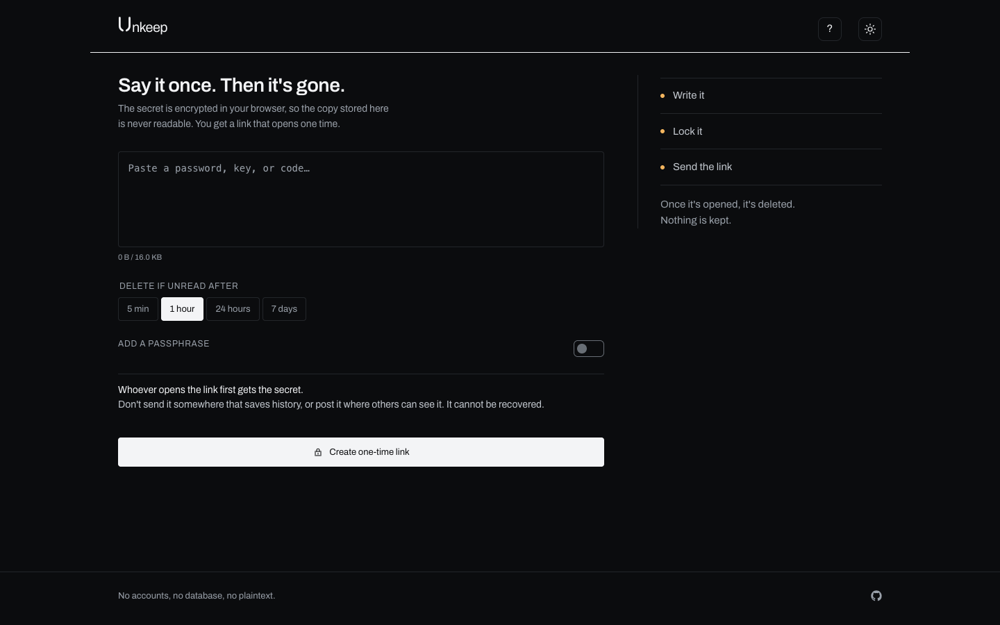

# unkeep

**Zero-knowledge, one-view secret sharing.** The browser encrypts a short secret
with AES-256-GCM. The server stores ciphertext only and releases it exactly once.
An optional passphrase wraps the key, and the sender can burn an unread link.

One Go binary serves both the API and the embedded frontend - copy the file and run it.

[Getting started](docs/getting_started.md) · [Changelog](CHANGELOG.md) · [API](#api) · [Configuration](#configuration) · [Security](#security-model)




| Property    | Value                                                |
| ----------- | ---------------------------------------------------- |
| Encryption  | AES-256-GCM in the browser                           |
| Key         | URL fragment only; never sent to the server          |
| Views       | 1; burn on release                                   |
| Storage     | In-process by default; optional volatile Valkey      |
| Persistence | None                                                 |
| Runtime     | One Go static binary with an embedded TypeScript SPA |

## Contents

- [Quick start](#quick-start)
- [Storage](#storage)
- [Deploy](#deploy)
- [Scaling](#scaling)
- [API](#api)
- [Security](#security-model)
- [Configuration](#configuration)
- [Limits](#limits)
- [Testing](#testing)

## Quick start

```bash
make build
./bin/unkeep
```

Open `http://127.0.0.1:8080`. No Valkey, database, or external service. Unread
secrets are lost on restart.

For Docker, Valkey, and multi-replica recipes, see
[docs/getting_started.md](docs/getting_started.md).

## Storage

**In-process (default).** Leave `VALKEY_URL` empty. Secrets and receipts live in
a mutex-guarded map. One process only; restart loses unread data.

**Valkey (shared, volatile).** Set `VALKEY_URL` to a RESP endpoint. Any app
replica can serve any secret ID. Valkey must run with persistence disabled and
must not lose data to swap or core dumps.

```conf
save ""
appendonly no
maxmemory 2gb
maxmemory-policy noeviction
```

Keys for secret `id`:


| Key                | Type       | Purpose                                     |
| ------------------ | ---------- | ------------------------------------------- |
| `ns:secret:{id}`   | hash       | IV, ciphertext, tag, proof hash, timestamps |
| `ns:receipt:{id}`  | hash       | token hashes, state, open count             |
| `ns:events:{id}`   | list       | capped event log                            |
| `ns:live:secrets`  | sorted set | live-secret capacity                        |
| `ns:live:receipts` | sorted set | receipt capacity                            |
| `ns:stats`         | hash       | lifecycle counters                          |


Create, challenge, burn, revoke, and receipt reads use Lua so fetch/delete and
receipt updates are atomic. The current implementation assumes one Valkey
instance; capacity indexes are not Cluster-safe.

`MAX_TOTAL_MB` compares against Valkey `used_memory`, so keep the instance
dedicated. `MAX_SECRETS` and `MAX_RECEIPTS` use the live indexes.

## Deploy

**Binary.** `bin/unkeep` is the artifact. A release build stamps the version
reported by `/metrics`:

```bash
make build VERSION=v1.0.0
```

Direct builds work from committed `frontend/dist` and `vendor/`:

```bash
go build -trimpath -ldflags="-s -w -X main.buildVersion=v1.0.0" -o bin/unkeep ./backend
```

`VERSION` defaults to `dev`; `BUILD_VERSION` overrides the stamped value at
runtime.

**Docker.** The image is a static Linux binary in `FROM scratch`, UID 65532, no
shell, no volumes. Build uses `vendor/`; no module download.

```bash
docker build --build-arg VERSION=v1.0.0 -t unkeep .
docker run --rm -p 127.0.0.1:8080:8080 \
  --read-only --cap-drop=ALL --security-opt no-new-privileges:true \
  --memory=512m --memory-swap=512m --ulimit core=0 \
  -e GOMEMLIMIT=400MiB -e GOTRACEBACK=none \
  unkeep
```

`docker-compose.yml` is the in-process stack. `docker-compose.valkey.yml` adds a
memory-only Valkey and requires `SESSION_SECRET` and `VALKEY_PASSWORD`. Use
`/healthz` for liveness and `/readyz` for readiness.

Docker bridge NAT adds a hop. Use host networking or a CNI for throughput, and
terminate TLS at an ingress/CDN.

## Scaling

1. **One process.** Simple and fast; the in-process map is the limit.
2. **Valkey + N app replicas.** Stateless API, shared volatile state, same
`SESSION_SECRET` everywhere. This is the supported scale-out path.
3. **Do not** put memory-only replicas behind plain round-robin. Valid links
will hit the wrong process and return `410`.

With multiple replicas, rate-limit buckets are per process. Move limits to the
edge or a shared counter store. The synchronous JSON logger also needs sampling
or async delivery at high request rates.

## API

Errors:

```json
{ "error": { "code": "unavailable", "message": "This secret is no longer available." } }
```

### `POST /api/secrets`

```json
{
  "envelope": {
    "v": 1,
    "alg": "A256GCM",
    "iv": "base64url-12-bytes",
    "ciphertext": "base64url",
    "tag": "base64url-16-bytes",
    "createdAt": 1800000000000,
    "expiresAt": 1800003600000,
    "maxViews": 1
  },
  "ttlSeconds": 3600,
  "proof": "base64url-32-byte-proof"
}
```

`proof` is `SHA-256("not-saved:open-proof:v1" || key)`. The server stores only
its hash. A wrong or missing proof gets `403` without burning.

`201` returns `secretId`, `expiresAt`, `receiptToken`, `receiptExpiresAt`,
`maxViews`. Server time and TTL are authoritative.

### `GET /api/secrets/{secretId}`

Returns metadata plus a short-lived, session-bound challenge. No ciphertext, no
burn. First call emits `link_opened`; later calls increment `opens`.

```json
{ "secretId": "...", "expiresAt": 1800003600000, "maxViews": 1,
  "challenge": "...", "challengeExpiresAt": 1800000120000 }
```

### `POST /api/secrets/{secretId}/open`

Requires the `ns_sid` cookie, the challenge, `X-Not-Saved-Confirm: reveal`,
`X-Secret-Proof`, and `{ "challenge": "...", "confirmation": "reveal" }`.

`200` returns the envelope, a `viewToken`, and `burnedAt`. The record is removed
atomically. A second attempt gets `410`; a bad proof gets `403` and does not burn.

### `POST /api/secrets/{secretId}/revoke`

Headers: `X-Receipt-Token` and `X-Not-Saved-Confirm: revoke`. Removes an unread
secret and emits `revoked`. Idempotent. Wrong token or unknown secret: `404`.

```json
{ "state": "revoked", "revokedAt": 1800000000000 }
```

### `POST /api/secrets/{secretId}/decrypted`

Body `{ "viewToken": "..." }`. `200 {"ok":true}`. Idempotent. Emits `decrypted`;
the server cannot verify decryption itself.

### `POST /api/secrets/{secretId}/receipt`

Header `X-Receipt-Token`. Returns state, timestamps, `opens`, `lastOpenedAt`,
`decrypted`, and events: `created`, `link_opened`, `decrypt_attempted`,
`burned`, `decrypted`, `expired`, `revoked`. `link_opened` is logged once.

### Other routes

- `GET /` — SPA
- `GET /s/{id}`, `GET /receipt/{id}` — SPA shells
- `GET /healthz` — liveness
- `GET /readyz` — `200` or `503`
- `GET /metrics` — Prometheus; `404` unless `METRICS_TOKEN` is set
- `GET /robots.txt` — disallow all

## Security model

- 256-bit AES-GCM key generated in the browser; key only in the URL fragment.
- Fresh 12-byte IV per encryption.
- Passphrase fragments use PBKDF2-SHA256 (600k rounds, 16-byte salt) and
AES-GCM key wrapping; wrong passphrase burns nothing.
- The built-in passphrase generator builds a five-word sentence
(32/59/8/32/64 word slots, ~25 bits of choice entropy). That is a speed bump on
offline guessing, not a secret: use your own long passphrase for anything
sensitive. The generator exists so a person can retype one.
- Passphrase attempts are throttled in the browser: the first two failures are
free, then cooldowns of 5 s, 15 s, 60 s, 3 min, and 5 min (capped) are kept per
link in `sessionStorage`, so a reload does not reset them. The server never
sees a guess, so this limits guessing through the UI only; anyone holding the
fragment can brute-force offline, bounded by the 600k-round PBKDF2 cost.
- Server sees ciphertext, IV, tag, TTL, max-view metadata, and a key proof hash.
Never plaintext or the key.
- Burn happens when ciphertext is released. Failed decrypt still burns.
- In-process mode zeroes secret buffers on burn, revoke, expiry, receipt
eviction, and shutdown. Valkey deletes keys via Lua/TTL, but it cannot
guarantee allocator-level zeroing; strict wipe requires in-process mode.
Token hashes are wiped when an in-memory receipt is removed.
- `maxViews` is fixed at `1`; other values are rejected.
- Receipt and view tokens are hashed; comparisons are constant-time.
- Challenges are HMAC-signed, expire in two minutes, bound to secret ID and
session cookie. Replay cannot retrieve twice; the record is gone.
- `/open` requires same-origin, custom header, cookie, nonce, proof, and explicit
confirmation.
- `/s/{id}` is a static shell: previews see no ciphertext, and no event or burn
happens before a human clicks **Open secret**.
- HSTS, strict CSP, `nosniff`, `no-referrer`, frame denial, COOP/CORP,
Permissions Policy, `no-store`, `X-Robots-Tag`.
- Logs contain route pattern, status, duration, error class only.
- Rate limits are per-process token buckets keyed by an HMAC of client IP.
- No analytics, durable database, backup, or outbound call. Valkey must stay
volatile.

## Configuration


| Variable                         | Default     | Meaning                                            |
| -------------------------------- | ----------- | -------------------------------------------------- |
| `HOST`                           | `127.0.0.1` | Bind host.                                         |
| `PORT`                           | `8080`      | Bind port.                                         |
| `ADDR`                           | empty       | Overrides `HOST:PORT`.                             |
| `TLS_CERT_FILE` / `TLS_KEY_FILE` | empty       | Direct TLS; set both.                              |
| `TRUST_PROXY`                    | `false`     | Trust proxy forwarding headers.                    |
| `TRUST_PROXY_HOPS`               | `1`         | Proxies that append to `X-Forwarded-For`.          |
| `ALLOWED_HOSTS`                  | loopback    | Host allowlist for API routes.                     |
| `VALKEY_URL`                     | empty       | RESP URL; empty = in-process.                      |
| `VALKEY_PREFIX`                  | `ns:`       | Valkey key prefix.                                 |
| `SESSION_SECRET`                 | generated   | Base64url ≥32 random bytes; required with Valkey.  |
| `MIN_TTL_SECONDS`                | `60`        | Minimum sender TTL.                                |
| `MAX_TTL_SECONDS`                | `604800`    | Maximum TTL.                                       |
| `DEFAULT_TTL_SECONDS`            | `86400`     | TTL when omitted.                                  |
| `RECEIPT_GRACE_HOURS`            | `24`        | Receipt retention after expiry.                    |
| `MAX_SECRETS`                    | `10000`     | Live-secret cap.                                   |
| `MAX_RECEIPTS`                   | `50000`     | Receipt cap; live receipts never evicted.          |
| `MAX_TOTAL_MB`                   | `64`        | Ciphertext cap; Valkey uses `used_memory`.         |
| `MAX_BODY_KB`                    | `64`        | Request body limit.                                |
| `MAX_SECRET_BYTES`               | `32768`     | Per-secret ciphertext limit.                       |
| `RATE_CREATE_PER_MIN`            | `10`        | Create limit.                                      |
| `RATE_CHALLENGE_PER_MIN`         | `60`        | Challenge limit.                                   |
| `RATE_OPEN_PER_MIN`              | `30`        | Open/decrypt-confirm limit.                        |
| `RATE_RECEIPT_PER_MIN`           | `120`       | Receipt poll limit.                                |
| `METRICS_TOKEN`                  | empty       | Enables `/metrics`.                                |
| `BUILD_VERSION`                  | `dev`       | Metrics build label.                               |


```bash
SESSION_SECRET="$(openssl rand -base64 32 | tr '+/' '-_' | tr -d '=')"
TLS_CERT_FILE=/etc/unkeep/fullchain.pem TLS_KEY_FILE=/etc/unkeep/privkey.pem \
  HOST=0.0.0.0 PORT=443 ./bin/unkeep
```

Behind a proxy:

```bash
HOST=0.0.0.0 PORT=8080 TRUST_PROXY=1 ALLOWED_HOSTS=app.example.com \
  ./bin/unkeep
```

Text assets are already gzip-precompressed in process (precomputed at startup,
`Vary: Accept-Encoding`), so leave proxy compression off or it compresses twice.
The document is served with the stylesheet and the theme boot script inlined and
pinned by CSP hashes, so a first visit needs two requests (document, `app.js`).

Only trust proxy headers when the proxy overwrites them. The client address is
read `TRUST_PROXY_HOPS` entries from the right of `X-Forwarded-For` (the hop your
own proxy appended), so a client that sends its own header cannot pick its rate
limit bucket. IPv6 addresses are aggregated per `/64` for rate limiting.

## Limits

- Default is one process. Without `VALKEY_URL`, restart loses unread data.
- Valkey mode is still volatile. A Valkey restart loses unread data; a single
instance is assumed for the capacity indexes.
- No recovery if the sender loses the link.
- The full link is a bearer key; it can leak through history, screenshots, and
chat backups.
- Lost passphrase cannot be reset.
- The unlock limiter is client-side and bypassable; PBKDF2 cost is the only
defense against offline guessing of a wrapped link.
- Revoke needs the receipt token.
- Failed decrypt still burns.
- In-process mode wipes secret buffers on burn, revoke, TTL sweep, and shutdown.
Valkey deletes keys but cannot promise allocator-level zeroing.
- Client-side clearing is best-effort; browser strings cannot be zeroed.
- No malware defense. No CAPTCHA; a scripted browser can still drive the flow.
- A leaked link ID (not the fragment) is enough to make the sender's receipt
show an extra open; it cannot release the ciphertext without the key proof.
- Metrics are opt-in. In-process capacity can lag expiry by up to one second
(the create path re-sweeps expired records at most once a second); Valkey prunes
its indexes on create.
- The sender's result page holds the only copy of the link. It warns before
unloading, but a closed tab still loses the link; the ciphertext stays stored
until its TTL expires.

## Testing

```bash
go test ./...
go test -race ./...
cd frontend && npm test && npm run typecheck
```

Valkey integration tests are opt-in:

```bash
VALKEY_URL=redis://127.0.0.1:6380/0 \
  go test ./backend -run 'Valkey|APIWithValkey'
```

Coverage includes encryption/IV/tamper tests, key placement, atomic concurrent
burn, buffer wipe on burn/revoke/expiry/receipt retention/shutdown, Valkey key
deletion, receipts, capacity, metrics, headers, log redaction, crawler safety,
and no filesystem writes during a full flow.

## CI and release

`.github/workflows/ci.yml` runs on every push and pull request: `go vet`, tests
with and without `-race`, the Valkey integration suite against a memory-only
Valkey, frontend tests plus a check that committed `frontend/dist` matches its
sources, a container smoke test, and `govulncheck`.

Pushing a `v*` tag (`.github/workflows/release.yml`) builds static binaries for
linux and darwin on amd64 and arm64, publishes a multi-arch `ghcr.io` image, and
creates a GitHub release with the tarballs and `SHA256SUMS`. Dependabot keeps
Go, npm, Docker, and Actions versions current.
